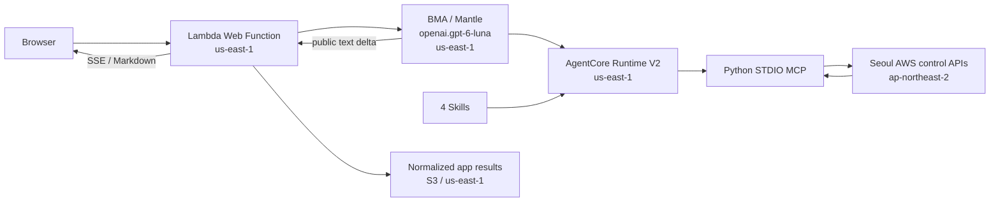

# AI-Powered AWS Operations Desk

[](LICENSE)
[](pyproject.toml)
<a href="#english"></a>
<a href="#korean"></a>

Connect natural-language questions to read-only Seoul AWS inventory through Bedrock Managed Agents | 자연어 질문을 BMA를 통해 서울 리전의 읽기 전용 AWS 조회로 연결합니다

---

<a id="english"></a>

# English

## Overview

AI-Powered AWS Operations Desk connects natural-language questions to Bedrock Managed Agents (BMA) Skills,
Python MCP tools, and real AWS control API reads. The app, **BMA, AgentCore Runtime V2, and result storage run in
`us-east-1`**; the query target is **`ap-northeast-2`** in the same account. The model is Mantle's
**`openai.gpt-6-luna`**.

The previous Oregon deployment of this project was deleted and migrated to US East (N. Virginia).
Check the actual deployment status and verification records in the [deployment report](docs/aws-deployment.md).

The project provides three scopes extracted from the original `/home/ec2-user/my-project/awsops`:
VPC/EBS/ECR with relationship diagrams, report history with DOCX/PPTX, and configuration reads and
security-setting checks for S3/DynamoDB/ElastiCache/OpenSearch/MSK. It currently supports
**24 MCP tools, 4 Skills, and 13 service categories**.

## Features

- **Read-only Seoul inventory** — Query `ap-northeast-2` control APIs through 24 registered MCP tools only after STS confirms the expected account; no arbitrary-command or generic boto3 operation tools exist.
- **Streaming BMA answers** — Forward public `agent.session.turn.output_text.delta` text over SSE and render it with react-markdown 10.1.0 + remark-gfm 4.0.1, showing query steps, elapsed time, and tool records without internal reasoning.
- **Reports with account masking** — Render saved results as Markdown/HTML/DOCX/PPTX reports that show only the last 3 digits of the account ID, without re-querying the model or resources.
- **Operations investigations** — Send follow-up questions to the same BMA session, recover the same run after reconnecting, and track four versioned operating procedures.
- **Relationship and security views** — Connect only actually observed resources in relationship diagrams and classify security checks as met, needs review, or unverified.

## Architecture



BMA reads the Skills in the Runtime and runs MCP with `agent.tools[].transport.type=stdio`.
The Runtime protocol is HTTP and the platform is V2; the official lifecycle server is unchanged.
The Web Function verifies the deployment account with STS and then creates a BMA session. MCP separately
verifies the Runtime's actual account and calls Seoul resource APIs only when the accounts match.

**Information queried in Seoul and passed to the model is analyzed by BMA in US East (N. Virginia).**
A Seoul query does not mean processing only within Seoul. Detailed retention policy and networking are in
[Data Processing and Scope](docs/data-and-scope.md). See the [architecture document](docs/architecture.md)
for the full layered architecture.

## Prerequisites

- Node.js 24 (`engines.node >= 24`; the Web Functions runtime supports Node.js 24 only)
- Python 3.12 and `uv`
- Docker with `linux/arm64` build support (Runtime image)
- AWS CLI v2 and `jq` (deployment)
- Official Codex 0.164.0 Linux ARM64 binary (Runtime build; located by `scripts/prepare_runtime.py`)
- AWS credentials for the target account (live mode, live verification, and deployment only)

## Installation

```bash
# Clone the repository
git clone https://github.com/whchoi98/bma-openai.git
cd bma-openai

# Install Node.js dependencies and build the UI
npm ci --ignore-scripts --prefix web
npm run build --prefix web

# Create the Python environment and install development dependencies
uv venv --python 3.12 .venv
uv pip install --python .venv/bin/python -e '.[dev]'
```

## Usage

Run the sample screen on Node.js 24. Sample mode does not call AWS APIs or the model.

```bash
DATA_MODE=sample node web/index.js
```

Open `http://127.0.0.1:3000` in the browser. `DATA_MODE`, the account, and the regions are server settings and
cannot be changed through questions or browser input. The sample account and observation time are fixed fixtures.

Run the MCP server in sample mode:

```bash
DATA_MODE=sample .venv/bin/python -m aws_inventory.mcp_server
```

The MCP server's stdout is reserved for JSON-RPC. The real MCP client connection is verified by `tests/test_mcp.py`.

## Configuration

| Variable | Description | Default |
|----------|-------------|---------|
| `APP_REGION` | Region for the app, BMA, Runtime, and result storage | `us-east-1` |
| `TARGET_REGION` | Region queried for AWS resources | `ap-northeast-2` |
| `EXPECTED_ACCOUNT_ID` | Account confirmed with STS at deployment; CloudFormation injects it with `AWS::AccountId` | (empty) |
| `DATA_MODE` | `live` or `sample`; missing settings are rejected at startup | `live` |
| `BMA_MODEL` | Model confirmed with the us-east-1 Mantle model list and BMA session creation | `openai.gpt-6-luna` |
| `AGENT_BACKEND` | Current backend `bma`; the selectable alternative is `converse` | `bma` |
| `CONVERSE_MODEL` | Designated inference profile for the Converse path | `global.openai.gpt-6-luna` |
| `MODEL_PROCESSING_SCOPE` | Runtime data-flow label: `global` for Converse, `app_region` for BMA; set in IaC | `app_region` |
| `BMA_RUNTIME_ARN` | us-east-1 Runtime ARN in the same account | (empty) |
| `BMA_SESSION_ROLE_ARN` | Designated BMA session role ARN in the same account | (empty) |
| `INVESTIGATION_WORKER_ARN` | Designated investigation worker Lambda ARN in the same account and us-east-1 | (empty) |
| `APP_STATE_BUCKET` | us-east-1 bucket that stores app results | (empty) |
| `APP_ACCESS_TOKEN` | Live-mode access key, at least 32 characters; never placed in source or the browser bundle | (empty) |
| `MAX_RESOURCES` | Maximum resources per tool; the value can only be lowered | `100` |
| `MAX_PAGES` | Maximum pages per tool | `10` |
| `MAX_METRIC_HOURS` | Maximum hours per metric query, within the last 7 days | `6` |
| `MAX_DATAPOINTS` | Maximum datapoints, 300-second buckets | `1440` |
| `MAX_TURN_SECONDS` | Agent run and stream limit; the current deployment uses 300 seconds | `180` |

Do not switch all of `AWS_REGION` to Seoul. Query boto3 clients set `region_name=TARGET_REGION`, and STS,
BMA signing, and the app S3 bucket set `APP_REGION` explicitly. The `AWS_REGION` used by the official Runtime
lifecycle is US East (N. Virginia).

The Web Function has permissions to invoke BMA, AssumeRole the designated session role, and store app results;
it has no Seoul query permissions. The session role uses only the selected model and the designated Runtime.
Query permissions exist only on the Runtime role. The operations investigation worker uses only the BMA session
API and limited app state and does not query AWS resources directly. The managed `ReadOnlyAccess` policy,
an arbitrary-command MCP, and a generic boto3 operation tool were not added.

## Project Structure

```text
bma-openai/
├── .claude/              # Claude Code settings, hooks, skills, commands, and agents
├── aws_inventory/        # Account checks, fixed-region boto3 clients, 24 MCP tools, normalization and limits
├── docs/                 # Design, deployment, data scope, and investigation guides
│   ├── architecture.md   # System architecture document
│   ├── reference/        # Layer-by-layer implementation references
│   ├── runbooks/         # Operational runbooks
│   └── decisions/        # Architecture Decision Records
├── infra/                # CloudFormation bootstrap and application stacks
├── runtime/              # Official BMA lifecycle server, HTTP-to-STDIO MCP bridge, ARM64 Dockerfile
├── scripts/              # Preflight, build, deployment, and live verification scripts
├── skills/               # 4 BMA Skills packaged into the Runtime image
├── tests/                # Python tests and the tests/run-all.sh harness suite
├── web/                  # Node.js 24 Web Function, BMA/Converse clients, reports, React answer components
└── webapp/               # Python local reference app and shared static UI
```

### Key Files

| Path | Role |
| --- | --- |
| `aws_inventory/` | Account/owner verification, fixed-region boto3 clients, 24 MCP tools, normalization and limits |
| `skills/` | Inventory, health check, and operations report Skills |
| `runtime/` | Official BMA lifecycle server, restricted HTTP-to-STDIO MCP bridge, ARM64 Dockerfile |
| `web/` | Node.js 24 BMA/Converse clients, web server, reports, React answer components |
| `webapp/static/` | Shared screen showing both regions, live/sample mode, and query records |
| `webapp/` | Python local reference HTTP app, fixed response generation, and local report writing |
| `infra/` | 4 roles, Runtime V2, Web Function, investigation worker Lambda, app S3 |
| `scripts/` | Account preflight, builds, and small-scale live queries |
| `tests/`, `web/tests/` | Stubber, MCP STDIO, HTTP/SSE, and IAM policy scope verification |

## Testing

```bash
# Python tests (Stubber, MCP STDIO, IAM policy scope)
.venv/bin/python -m pytest

# Node.js tests (BMA/Converse clients, HTTP/SSE, reports, investigations)
npm test --prefix web

# Lint
.venv/bin/ruff check .

# Claude Code harness tests (hooks, secret patterns, project structure)
bash tests/run-all.sh
```

## API Documentation

The Web Function serves `/health` and the `/api/*` routes: `/api/context`, `/api/chat` (SSE), `/api/runs`,
`/api/runs/{id}`, `/api/runs/{id}/report.{md|html|docx|pptx}`, `/api/procedures`, and `/api/investigations`
with its turn, event, and cancel sub-routes. When an access key is configured, `/api/*` requires
`Authorization: Bearer <APP_ACCESS_TOKEN>`; unauthenticated API requests return 401.
See the [API reference](docs/api-reference.md) for request and response details.

## Contributing

1. Fork the repository
2. Create your branch (`git checkout -b feat/amazing-feature`)
3. Commit changes (`git commit -m 'feat: add amazing feature'`)
4. Push to the branch (`git push origin feat/amazing-feature`)
5. Open a Pull Request

Use [Conventional Commits](https://www.conventionalcommits.org/) for commit messages:

```bash
git commit -m "feat: add ElastiCache encryption check"
git commit -m "fix: mask account IDs split across Markdown emphasis"
git commit -m "docs: update deployment runbook"
```

## License

This project is licensed under the [MIT No Attribution (MIT-0)](LICENSE) license.
`runtime/lifecycle/server.py` is included unchanged from the official `@aws/agentcore` npm package 1.0.0 and
remains under its original Apache License 2.0 in [runtime/LICENSE-AGENTCORE](runtime/LICENSE-AGENTCORE).
See [runtime/UPSTREAM.md](runtime/UPSTREAM.md) for its source.

## Contact

- Maintainer: [WooHyung Choi (whchoi98)](https://github.com/whchoi98)
- Issues: [github.com/whchoi98/bma-openai/issues](https://github.com/whchoi98/bma-openai/issues)

## Model, UI, and Streaming

- The current configuration is `AGENT_BACKEND=bma`, `BMA_MODEL=openai.gpt-6-luna`.
  Public answers from `agent.session.turn.output_text.delta` are forwarded over SSE immediately.
- The existing `AGENT_BACKEND=converse` implementation remains as a selectable alternative.
  This path uses `global.openai.gpt-6-luna` and `ConverseStreamCommand` and displays the global processing
  scope separately. The current BMA deployment does not grant global inference permissions.
- Answers render with **react-markdown 10.1.0 + remark-gfm 4.0.1**.
  The UI shows query steps, elapsed time, and tool records; internal reasoning is neither displayed nor stored.
- The font is the local NAVER **NanumSquare OTF Bold**. The OFL license is included and no CDN is used.
- The header toggles dark mode and Korean/English and shows the actual model ID and execution/query regions.
- The UI and the Markdown/HTML/DOCX/PPTX reports show only the last 3 digits of the account ID.
  STS comparison and the original evidence in S3 keep the full account ID.
- **View HTML report** renders a saved report. Loading history, previews, and document conversion do not
  re-query the model or resources.
- Relationship diagrams connect only actually observed resources. Security configuration checks distinguish
  met, needs review, and unverified.
- **Operations investigations** send follow-up questions to the same BMA session and recover the same run after
  reconnecting. They show the versions and actual step status of four operating procedures and preserve the
  original timestamps of earlier evidence. The existing **single question** mode creates a new session for each
  question. See the [usage guide](docs/bma-investigations.md).

## Deployment Preparation

First check the deploying principal's account and the model list. Listing models is not an inference call.

```bash
.venv/bin/python scripts/preflight.py --list-models
.venv/bin/python scripts/prepare_runtime.py
docker build --platform linux/arm64 -f runtime/Dockerfile -t bma-seoul-runtime:0.1.0 .
.venv/bin/python scripts/build_web.py
```

`prepare_runtime.py` locates the officially installed **Codex 0.164.0 Linux ARM64** binary.
If it is in another location, pass `--source /path/to/codex`. The script checks the version, ELF architecture,
and exec-server options. The Web Function ZIP contains the Node.js code, its dependencies, and the static UI.
`artifacts/deployment-context.json` records the verified real account; if the account changes in a later check,
the script stops instead of overwriting the existing expected account.

The commands below reproduce the deployment. The current deployment and actual verification results are recorded
in the [AWS deployment report](docs/aws-deployment.md). For the step-by-step operational procedure, follow the
[deployment runbook](docs/runbooks/deploy-production.md).

```bash
export APP_REGION=us-east-1 TARGET_REGION=ap-northeast-2
export EXPECTED_ACCOUNT_ID="$(jq -r .expected_account_id artifacts/deployment-context.json)"
export BMA_MODEL=openai.gpt-6-luna
export AGENT_BACKEND=bma MODEL_PROCESSING_SCOPE=app_region

aws cloudformation deploy --region "$APP_REGION" \
  --stack-name bma-seoul-build --template-file infra/bootstrap.yaml \
  --parameter-overrides WebFunctionName=bma-seoul-inventory-web

export BMA_CODE_BUCKET="$(aws cloudformation describe-stacks --region "$APP_REGION" \
  --stack-name bma-seoul-build --query 'Stacks[0].Outputs[?OutputKey==`CodeBucket`].OutputValue | [0]' --output text)"
export BMA_ECR_URI="$(aws cloudformation describe-stacks --region "$APP_REGION" \
  --stack-name bma-seoul-build --query 'Stacks[0].Outputs[?OutputKey==`RuntimeRepositoryUri`].OutputValue | [0]' --output text)"

aws ecr get-login-password --region "$APP_REGION" |
  docker login --username AWS --password-stdin "${BMA_ECR_URI%%/*}"
docker tag bma-seoul-runtime:0.1.0 "$BMA_ECR_URI:0.1.0"
docker push "$BMA_ECR_URI:0.1.0"
export BMA_IMAGE_DIGEST="$(aws ecr describe-images --region "$APP_REGION" \
  --repository-name bma-seoul-runtime --image-ids imageTag=0.1.0 --query 'imageDetails[0].imageDigest' --output text)"

aws s3api put-object --region "$APP_REGION" --bucket "$BMA_CODE_BUCKET" \
  --key web/0.1.0.zip --body artifacts/web-function.zip > artifacts/code-upload.json
export BMA_CODE_VERSION="$(jq -r .VersionId artifacts/code-upload.json)"
```

Enter the real access key in the terminal with `read -rs APP_ACCESS_TOKEN`, then export it as an environment
variable. Create the CloudFormation parameter file below locally with mode 0600 and do not commit it to Git.

```bash
read -rs APP_ACCESS_TOKEN
export APP_ACCESS_TOKEN
.venv/bin/python scripts/deployment_parameters.py
aws cloudformation deploy --region "$APP_REGION" \
  --stack-name bma-seoul-inventory --template-file infra/template.yaml \
  --capabilities CAPABILITY_IAM --parameter-overrides file://artifacts/deploy-parameters.json
```

Open the `WebUrl` output and enter the access key. The key stays only in browser memory.
This approach is for demos shared by trusted users; per-user accounts and tenant isolation are not implemented.
When updating, use a new version for the immutable ECR tag and specify the new ZIP's S3 VersionId and image digest.
Do not use `--disable-rollback` for Web Revision replacement updates.
When renaming the stack, also match bootstrap's `WebFunctionName` to the actual function name.
To pass deployment limits, set the `MAX_RESOURCES`, `MAX_PAGES`, `MAX_METRIC_HOURS`, `MAX_DATAPOINTS`, and
`MAX_TURN_SECONDS` environment variables before running `deployment_parameters.py`.
To use a content-hash-based code path, also set `BMA_CODE_KEY`.

## Live Verification

```bash
.venv/bin/python scripts/preflight.py
.venv/bin/python scripts/live_smoke.py
```

The smoke test queries at most 2 returned resources per service, 1 ECS cluster, and the last 15 minutes of
metrics for 1 Lambda function. Even when it reads a service API's minimum page size (for example, EC2 5, RDS 20),
it exports at most 2 resources to the model and results and marks the truncation. The executing principal is
the current local AWS credentials, which is distinct from verifying the deployed Runtime role.

Verification evidence is saved in `artifacts/live-smoke.json` and in Markdown and HTML reports.
The overall verification status and unexecuted items are in [Verification Results](docs/verification.md).

## Related Documents

- [BMA operations investigations: follow-up questions, reconnection, procedure catalog](docs/bma-investigations.md)
- [Service API and IAM mapping](docs/api-iam.md)
- [Real AWS deployment and end-to-end verification](docs/aws-deployment.md)
- [Feature extraction and implementation from the original awsops](docs/awsops-extraction.md)
- [Review of additional features to integrate from awsops_v2](docs/awsops-v2-integration-review.md)
- [Korean demo scenario](docs/demo-ko.md)
- [Data processing, networking, cost limits, and unsupported scope](docs/data-and-scope.md)
- [Design](docs/design.md), [implementation plan](docs/implementation-plan.md)
- [Official lifecycle source](runtime/UPSTREAM.md)

Official references: [BMA example repository](https://github.com/openai-on-aws/bedrock-managed-agents),
[AWS BMA guide](https://docs.aws.amazon.com/bedrock/latest/userguide/bedrock-managed-agents-openai.html),
[OpenAI guide for Amazon Bedrock](https://developers.openai.com/api/docs/guides/amazon-bedrock).

---

<a id="korean"></a>

# 한국어

## 개요

AI-Powered AWS Operations Desk는 자연어 질문을 BMA(Bedrock Managed Agents)의 Skills, Python MCP 도구,
실제 AWS 제어 API 조회로 연결합니다. 앱, **BMA, AgentCore Runtime V2, 결과 저장은 `us-east-1`**, 조회 대상은 같은 계정의
**`ap-northeast-2`**입니다. 사용 모델은 Mantle의 **`openai.gpt-6-luna`**입니다.

이 프로젝트의 기존 오레곤 배포를 삭제하고 버지니아 북부로 이전했습니다.
실제 배포 상태와 검증 기록은 [배포 보고서](docs/aws-deployment.md)에서 확인합니다.

원본 `/home/ec2-user/my-project/awsops`에서 추출한 세 범위를 제공합니다.
VPC/EBS/ECR과 관계도, 보고서 이력과 DOCX/PPTX, S3/DynamoDB/ElastiCache/OpenSearch/MSK의
구성 조회와 보안 설정 점검입니다. 현재 **24개 MCP 도구, 4개 Skills, 13개 서비스 범주**를 지원합니다.

## 주요 기능

- **읽기 전용 서울 인벤토리** — STS로 기대 계정을 확인한 뒤에만 등록된 24개 MCP 도구로 `ap-northeast-2` 제어 API를 조회합니다. 임의 명령 실행 도구나 범용 boto3 operation 도구는 없습니다.
- **BMA 스트리밍 답변** — `agent.session.turn.output_text.delta`의 공개 답변을 SSE로 전달하고 react-markdown 10.1.0 + remark-gfm 4.0.1로 렌더링합니다. 조회 단계, 경과 시간, 도구 기록을 표시하며 내부 추론은 표시하지 않습니다.
- **계정 마스킹 보고서** — 저장된 결과를 Markdown/HTML/DOCX/PPTX 보고서로 렌더링하며 계정 ID는 마지막 3자리만 표시합니다. 모델이나 리소스를 다시 조회하지 않습니다.
- **운영 조사** — 같은 BMA 세션에 후속 질문을 보내고, 재접속 후 같은 실행을 복구하며, 버전이 있는 네 가지 운영 절차를 추적합니다.
- **관계도와 보안 점검** — 관계도는 실제 관측된 리소스만 연결하고, 보안 구성 점검은 기준 충족, 확인 필요, 미확인을 구분합니다.

## 아키텍처


BMA는 Runtime의 Skills를 읽고 `agent.tools[].transport.type=stdio`로 MCP를 실행합니다.
Runtime 프로토콜은 HTTP, 플랫폼은 V2이며 공식 lifecycle 서버는 변경하지 않았습니다.
Web Function은 STS로 배포 계정을 확인한 뒤 BMA 세션을 만듭니다. MCP는 별도로 Runtime의
실제 계정을 확인하고, 일치할 때만 서울 리소스 API를 호출합니다.

**서울에서 조회한 정보 중 모델에 전달한 내용은 버지니아 북부 BMA에서 분석됩니다.**
서울 조회가 서울 내 처리만을 뜻하지 않습니다. 세부 보존 정책과 네트워크는
[데이터 처리와 범위](docs/data-and-scope.md)에 있습니다. 전체 계층 구조는
[아키텍처 문서](docs/architecture.md)를 참고합니다.

## 사전 요구 사항

- Node.js 24 (`engines.node >= 24`; Web Functions 런타임은 Node.js 24만 지원합니다)
- Python 3.12와 `uv`
- `linux/arm64` 빌드를 지원하는 Docker (Runtime 이미지)
- AWS CLI v2와 `jq` (배포)
- 공식 Codex 0.164.0 Linux ARM64 바이너리 (Runtime 빌드; `scripts/prepare_runtime.py`가 위치를 찾습니다)
- 대상 계정의 AWS 자격증명 (실제 모드, 실제 조회 검증, 배포에만 필요합니다)

## 설치 방법

```bash
# Clone the repository
git clone https://github.com/whchoi98/bma-openai.git
cd bma-openai

# Install Node.js dependencies and build the UI
npm ci --ignore-scripts --prefix web
npm run build --prefix web

# Create the Python environment and install development dependencies
uv venv --python 3.12 .venv
uv pip install --python .venv/bin/python -e '.[dev]'
```

## 사용법

Node.js 24에서 샘플 화면을 실행합니다. 샘플은 AWS API와 모델을 호출하지 않습니다.

```bash
DATA_MODE=sample node web/index.js
```

브라우저에서 `http://127.0.0.1:3000`을 엽니다. `DATA_MODE`, 계정과 리전은 서버 설정이며
질문이나 브라우저 입력으로 변경할 수 없습니다. 샘플 계정과 관측 시각은 고정된 fixture입니다.

샘플 모드로 MCP 서버를 실행합니다.

```bash
DATA_MODE=sample .venv/bin/python -m aws_inventory.mcp_server
```

MCP 서버의 stdout은 JSON-RPC 전용입니다. 실제 MCP 클라이언트 연결은 `tests/test_mcp.py`로 검증합니다.

## 환경 설정

| Variable | Description | Default |
|----------|-------------|---------|
| `APP_REGION` | 앱, BMA, Runtime, 결과 저장 리전 | `us-east-1` |
| `TARGET_REGION` | AWS 리소스 조회 대상 리전 | `ap-northeast-2` |
| `EXPECTED_ACCOUNT_ID` | 배포 시 STS로 확인한 계정. CloudFormation은 `AWS::AccountId`로 주입 | (비어 있음) |
| `DATA_MODE` | `live` 또는 `sample`; 누락 설정은 시작 단계에서 거부 | `live` |
| `BMA_MODEL` | us-east-1 Mantle 목록과 BMA 세션 생성으로 확인한 모델 | `openai.gpt-6-luna` |
| `AGENT_BACKEND` | 현재 `bma`; 선택 가능한 대안은 `converse` | `bma` |
| `CONVERSE_MODEL` | Converse 경로의 지정 추론 프로파일 | `global.openai.gpt-6-luna` |
| `MODEL_PROCESSING_SCOPE` | Runtime 데이터 흐름 표시: Converse는 `global`, BMA는 `app_region`; IaC에서 설정 | `app_region` |
| `BMA_RUNTIME_ARN` | 같은 계정의 us-east-1 Runtime ARN | (비어 있음) |
| `BMA_SESSION_ROLE_ARN` | 같은 계정의 지정 BMA 세션 역할 ARN | (비어 있음) |
| `INVESTIGATION_WORKER_ARN` | 같은 계정과 us-east-1의 지정 조사 worker Lambda ARN | (비어 있음) |
| `APP_STATE_BUCKET` | us-east-1 앱 결과 저장 버킷 | (비어 있음) |
| `APP_ACCESS_TOKEN` | 실제 모드 접속 키, 최소 32자. 소스·브라우저 번들에 넣지 않음 | (비어 있음) |
| `MAX_RESOURCES` | 도구당 최대 리소스 수; 값을 줄일 수만 있음 | `100` |
| `MAX_PAGES` | 도구당 최대 페이지 수 | `10` |
| `MAX_METRIC_HOURS` | 한 번에 조회하는 최대 시간, 최근 7일 이내 | `6` |
| `MAX_DATAPOINTS` | 최대 데이터 포인트 수, 300초 버킷 | `1440` |
| `MAX_TURN_SECONDS` | 에이전트 실행·스트림 한도; 현재 배포는 300초 | `180` |

`AWS_REGION` 전체를 서울로 바꾸지 않습니다. 조회 boto3 클라이언트는
`region_name=TARGET_REGION`, STS·BMA 서명·앱 S3는 `APP_REGION`을 명시합니다.
Runtime의 공식 lifecycle이 사용하는 `AWS_REGION`은 버지니아 북부입니다.

Web Function은 BMA 호출·지정 세션 역할 AssumeRole·앱 결과 저장 권한을 가지며 서울 조회 권한이 없습니다.
세션 역할은 선택 모델과 지정 Runtime만 사용합니다. 조회 권한은 Runtime 역할에만 있습니다.
운영 조사 worker는 BMA 세션 API와 제한된 앱 상태만 사용하며 직접 AWS 리소스를 조회하지 않습니다.
관리형 `ReadOnlyAccess`, 임의 명령 실행 MCP, 범용 boto3 operation 도구는 추가하지 않았습니다.

## 프로젝트 구조

```text
bma-openai/
├── .claude/              # Claude Code 설정, hook, skill, 명령, 에이전트
├── aws_inventory/        # 계정 검증, 고정 리전 boto3 클라이언트, 24개 MCP 도구, 정규화와 한도
├── docs/                 # 설계, 배포, 데이터 범위, 운영 조사 문서
│   ├── architecture.md   # 시스템 아키텍처 문서
│   ├── reference/        # 계층별 구현 참조 문서
│   ├── runbooks/         # 운영 런북
│   └── decisions/        # 아키텍처 결정 기록(ADR)
├── infra/                # CloudFormation bootstrap 스택과 애플리케이션 스택
├── runtime/              # 공식 BMA lifecycle 서버, HTTP→STDIO MCP bridge, ARM64 Dockerfile
├── scripts/              # 사전 확인, 빌드, 배포, 실제 조회 검증 스크립트
├── skills/               # Runtime 이미지에 포함되는 BMA Skills 4개
├── tests/                # Python 테스트와 tests/run-all.sh 하네스 테스트
├── web/                  # Node.js 24 Web Function, BMA/Converse 클라이언트, 보고서, React 답변 컴포넌트
└── webapp/               # Python 로컬 참조 앱과 공통 정적 화면
```

### 주요 파일

| 경로 | 역할 |
| --- | --- |
| `aws_inventory/` | 계정/소유자 검증, 고정 리전 boto3 클라이언트, 24개 MCP 도구, 정규화·한도 |
| `skills/` | 인벤토리·상태 확인·운영 보고서 Skills |
| `runtime/` | 공식 BMA lifecycle 서버, 제한된 HTTP→STDIO MCP bridge, ARM64 Dockerfile |
| `web/` | Node.js 24 BMA/Converse 클라이언트·웹 서버·보고서, React 답변 컴포넌트 |
| `webapp/static/` | 두 리전·실제/샘플 모드·조회 기록을 표시하는 공통 화면 |
| `webapp/` | Python 로컬 참조 HTTP 앱, 고정 응답 생성 및 로컬 보고서 작성 |
| `infra/` | 역할 4개, Runtime V2, Web Function, 조사 worker Lambda, 앱 S3 |
| `scripts/` | 계정 사전 확인, 빌드, 소규모 실제 조회 |
| `tests/`, `web/tests/` | Stubber, MCP STDIO, HTTP/SSE, IAM 정책 범위 검증 |

## 테스트

```bash
# Python tests (Stubber, MCP STDIO, IAM policy scope)
.venv/bin/python -m pytest

# Node.js tests (BMA/Converse clients, HTTP/SSE, reports, investigations)
npm test --prefix web

# Lint
.venv/bin/ruff check .

# Claude Code harness tests (hooks, secret patterns, project structure)
bash tests/run-all.sh
```

## API 문서

Web Function은 `/health`와 `/api/*` 경로를 제공합니다. `/api/context`, `/api/chat`(SSE), `/api/runs`,
`/api/runs/{id}`, `/api/runs/{id}/report.{md|html|docx|pptx}`, `/api/procedures`, 그리고 turn·event·cancel
하위 경로를 가진 `/api/investigations`입니다. 접속 키가 설정되어 있으면 `/api/*`는
`Authorization: Bearer <APP_ACCESS_TOKEN>`이 필요하며, 인증하지 않은 API 요청은 401을 반환합니다.
요청과 응답의 세부 내용은 [API 레퍼런스](docs/api-reference.md)를 참고합니다.

## 기여 방법

1. 저장소를 Fork합니다
2. 브랜치를 만듭니다 (`git checkout -b feat/amazing-feature`)
3. 변경 사항을 커밋합니다 (`git commit -m 'feat: add amazing feature'`)
4. 브랜치에 Push합니다 (`git push origin feat/amazing-feature`)
5. Pull Request를 엽니다

커밋 메시지는 [Conventional Commits](https://www.conventionalcommits.org/)를 따릅니다.

```bash
git commit -m "feat: add ElastiCache encryption check"
git commit -m "fix: mask account IDs split across Markdown emphasis"
git commit -m "docs: update deployment runbook"
```

## 라이선스

이 프로젝트는 [MIT No Attribution (MIT-0)](LICENSE) 라이선스를 따릅니다.
`runtime/lifecycle/server.py`는 공식 `@aws/agentcore` npm 패키지 1.0.0의 파일을 변경 없이 포함했으며,
원본 Apache License 2.0인 [runtime/LICENSE-AGENTCORE](runtime/LICENSE-AGENTCORE)를 따릅니다.
출처는 [runtime/UPSTREAM.md](runtime/UPSTREAM.md)에 있습니다.

## 연락처

- 메인테이너: [WooHyung Choi (whchoi98)](https://github.com/whchoi98)
- 이슈: [github.com/whchoi98/bma-openai/issues](https://github.com/whchoi98/bma-openai/issues)

## 모델, 화면과 스트리밍

- 현재 구성은 `AGENT_BACKEND=bma`, `BMA_MODEL=openai.gpt-6-luna`입니다.
  `agent.session.turn.output_text.delta`의 공개 답변을 SSE로 즉시 전달합니다.
- 기존 `AGENT_BACKEND=converse` 구현은 선택 가능한 대안으로 남아 있습니다.
  이 경로는 `global.openai.gpt-6-luna`와 `ConverseStreamCommand`를 사용하며
  글로벌 처리 범위를 별도로 표시합니다. 현재 BMA 배포에는 글로벌 추론 권한을 부여하지 않습니다.
- 답변은 **react-markdown 10.1.0 + remark-gfm 4.0.1**로 렌더링합니다.
  조회 단계, 경과 시간과 도구 기록을 표시하며 내부 추론은 표시하거나 저장하지 않습니다.
- 폰트는 로컬 NAVER **나눔스퀘어 OTF Bold**입니다. OFL 라이선스를 포함하고 CDN을 사용하지 않습니다.
- 상단에서 다크 모드와 한국어/English를 전환하며 실제 모델 ID와 실행/조회 리전을 표시합니다.
- 화면과 Markdown/HTML/DOCX/PPTX 보고서의 계정 ID는 마지막 3자리만 표시합니다.
  STS 비교와 S3의 원본 근거는 전체 계정 ID를 유지합니다.
- **HTML 보고서 보기**는 저장된 보고서를 렌더링합니다. 이력 로드, 미리보기와 문서 변환은
  모델이나 리소스를 다시 조회하지 않습니다.
- 관계도는 실제 관측된 리소스만 연결합니다. 보안 구성 점검은 기준 충족, 확인 필요, 미확인을 구분합니다.
- **운영 조사**에서는 같은 BMA 세션에 후속 질문을 보내고, 재접속 후 같은 실행을 복구합니다.
  네 가지 운영 절차의 버전과 실제 단계 상태를 표시하며 이전 근거의 원본 시각을 보존합니다.
  기존 **단일 질문** 모드는 질문마다 새 세션을 만듭니다. [사용 방법](docs/bma-investigations.md)을 참고합니다.

## 배포 준비

먼저 배포 주체의 계정과 모델 목록을 확인합니다. 모델 목록 조회는 추론 호출이 아닙니다.

```bash
.venv/bin/python scripts/preflight.py --list-models
.venv/bin/python scripts/prepare_runtime.py
docker build --platform linux/arm64 -f runtime/Dockerfile -t bma-seoul-runtime:0.1.0 .
.venv/bin/python scripts/build_web.py
```

`prepare_runtime.py`는 공식 설치된 **Codex 0.164.0 Linux ARM64** 바이너리를 찾습니다.
다른 위치라면 `--source /path/to/codex`를 지정합니다. 버전·ELF 아키텍처·exec-server 옵션을 검사합니다.
Web Function ZIP에는 Node.js 코드와 의존성·정적 화면이 들어갑니다.
`artifacts/deployment-context.json`은 확인한 실제 계정을 기록하며, 다음 검증에서 계정이 바뀌면
기존 기대 계정을 덮어쓰지 않고 중단합니다.

아래는 배포를 재현하는 명령입니다. 현재 배포와 실제 검증 결과는
[AWS 배포 보고서](docs/aws-deployment.md)에 기록했습니다. 단계별 운영 절차는
[배포 런북](docs/runbooks/deploy-production.md)을 따릅니다.

```bash
export APP_REGION=us-east-1 TARGET_REGION=ap-northeast-2
export EXPECTED_ACCOUNT_ID="$(jq -r .expected_account_id artifacts/deployment-context.json)"
export BMA_MODEL=openai.gpt-6-luna
export AGENT_BACKEND=bma MODEL_PROCESSING_SCOPE=app_region

aws cloudformation deploy --region "$APP_REGION" \
  --stack-name bma-seoul-build --template-file infra/bootstrap.yaml \
  --parameter-overrides WebFunctionName=bma-seoul-inventory-web

export BMA_CODE_BUCKET="$(aws cloudformation describe-stacks --region "$APP_REGION" \
  --stack-name bma-seoul-build --query 'Stacks[0].Outputs[?OutputKey==`CodeBucket`].OutputValue | [0]' --output text)"
export BMA_ECR_URI="$(aws cloudformation describe-stacks --region "$APP_REGION" \
  --stack-name bma-seoul-build --query 'Stacks[0].Outputs[?OutputKey==`RuntimeRepositoryUri`].OutputValue | [0]' --output text)"

aws ecr get-login-password --region "$APP_REGION" |
  docker login --username AWS --password-stdin "${BMA_ECR_URI%%/*}"
docker tag bma-seoul-runtime:0.1.0 "$BMA_ECR_URI:0.1.0"
docker push "$BMA_ECR_URI:0.1.0"
export BMA_IMAGE_DIGEST="$(aws ecr describe-images --region "$APP_REGION" \
  --repository-name bma-seoul-runtime --image-ids imageTag=0.1.0 --query 'imageDetails[0].imageDigest' --output text)"

aws s3api put-object --region "$APP_REGION" --bucket "$BMA_CODE_BUCKET" \
  --key web/0.1.0.zip --body artifacts/web-function.zip > artifacts/code-upload.json
export BMA_CODE_VERSION="$(jq -r .VersionId artifacts/code-upload.json)"
```

실제 접속 키는 터미널에서 `read -rs APP_ACCESS_TOKEN`으로 입력한 뒤 환경 변수로 내보냅니다.
아래 CloudFormation parameter 파일은 로컬에서 모드 0600으로 만들고 Git에 포함하지 않습니다.

```bash
read -rs APP_ACCESS_TOKEN
export APP_ACCESS_TOKEN
.venv/bin/python scripts/deployment_parameters.py
aws cloudformation deploy --region "$APP_REGION" \
  --stack-name bma-seoul-inventory --template-file infra/template.yaml \
  --capabilities CAPABILITY_IAM --parameter-overrides file://artifacts/deploy-parameters.json
```

`WebUrl` 출력으로 접속한 뒤 접속 키를 입력합니다. 키는 브라우저 메모리에만 유지합니다.
이 방식은 신뢰된 사용자가 함께 쓰는 데모용이며 사용자별 계정·테넌트 격리는 구현하지 않았습니다.
업데이트할 때는 ECR의 불변 태그에 새 버전을 사용하고 새 ZIP의 S3 VersionId와 이미지 digest를 지정합니다.
Web Revision 교체 업데이트에는 `--disable-rollback`을 사용하지 않습니다.
스택 이름을 바꿀 때는 bootstrap의 `WebFunctionName`도 실제 함수 이름과 일치시킵니다.
배포 한도는 `MAX_RESOURCES`, `MAX_PAGES`, `MAX_METRIC_HOURS`, `MAX_DATAPOINTS`,
`MAX_TURN_SECONDS` 환경 변수를 설정한 뒤 `deployment_parameters.py`로 전달할 수 있습니다.
내용 해시 기반 코드 경로를 사용하려면 `BMA_CODE_KEY`도 설정합니다.

## 실제 조회 검증

```bash
.venv/bin/python scripts/preflight.py
.venv/bin/python scripts/live_smoke.py
```

서비스별 반환 리소스 최대 2개, ECS 클러스터 1개, Lambda 함수 1개의 최근 15분 지표만 조회합니다.
서비스 API의 최소 페이지 크기(예: EC2 5, RDS 20)만큼 읽은 경우에도 모델·결과에는 최대 2개만 내보내고
잘림을 표시합니다. 실행 주체는 현재 로컬 AWS 자격증명이며 배포된 Runtime 역할 검증과 구분합니다.

검증 근거는 `artifacts/live-smoke.json`, Markdown·HTML 보고서에 저장합니다.
전체 검증 상태와 미실행 항목은 [검증 결과](docs/verification.md)에 있습니다.

## 관련 문서

- [BMA 운영 조사: 후속 질문, 재접속, 절차 카탈로그](docs/bma-investigations.md)
- [서비스별 API·IAM 대응표](docs/api-iam.md)
- [실제 AWS 배포 및 종단 간 검증](docs/aws-deployment.md)
- [원본 awsops 기능 추출과 구현](docs/awsops-extraction.md)
- [awsops_v2에서 추가로 연동할 수 있는 기능 검토](docs/awsops-v2-integration-review.md)
- [한국어 데모 시나리오](docs/demo-ko.md)
- [데이터 처리·네트워크·비용 한도·미지원 범위](docs/data-and-scope.md)
- [설계](docs/design.md), [구현 계획](docs/implementation-plan.md)
- [공식 lifecycle 출처](runtime/UPSTREAM.md)

공식 참조: [BMA 예제 저장소](https://github.com/openai-on-aws/bedrock-managed-agents),
[AWS BMA 가이드](https://docs.aws.amazon.com/bedrock/latest/userguide/bedrock-managed-agents-openai.html),
[OpenAI의 Amazon Bedrock 가이드](https://developers.openai.com/api/docs/guides/amazon-bedrock).
