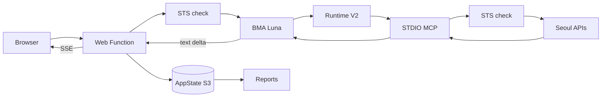
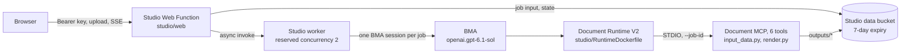
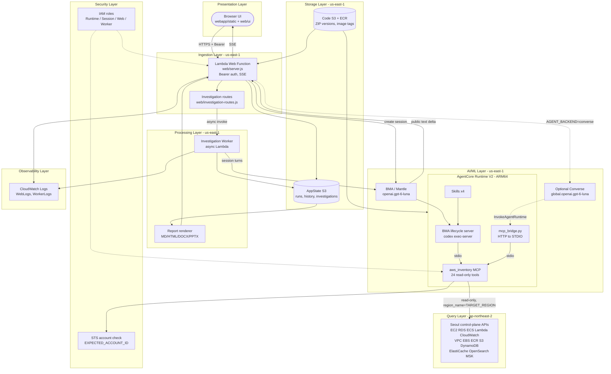

# Architecture

---

# English

## System Overview

AI-Powered AWS Operations Desk answers natural-language operations questions about one AWS account's Seoul (`ap-northeast-2`) resources.
A Node.js 24 Lambda Web Function in `us-east-1` creates Bedrock Managed Agents (BMA) sessions on the Mantle model `openai.gpt-6-luna`; BMA runs inside an AgentCore Runtime V2 container that loads 4 Skills and a read-only Python STDIO MCP server with 24 tools.
Public answer deltas stream back to the browser over SSE, and normalized evidence and reports are stored in a `us-east-1` S3 bucket. Data read from Seoul and passed to the model is analyzed in `us-east-1`.
A separate demo, [AI Document Studio](#ai-document-studio), reuses the BMA client and Runtime base but runs on its own stacks without AWS resource-query permissions.

## Components

### Presentation Layer
- **webapp/static/** -- Shared browser UI (`index.html`, `style.css`, `report.css`, local NanumSquare OTF). `app.js` is bundled by esbuild from `web/ui/`.
- **web/ui/** -- React 19 components: streaming answer with `react-markdown` 10.1.0 + `remark-gfm` 4.0.1, history panel, investigations panel, resource relationships, ko/en i18n, dark mode.

### Ingestion Layer
- **web/server.js** -- Lambda Web Function HTTP server. Bearer `APP_ACCESS_TOKEN` on `/api/*`, STS account check, max 2 concurrent `/api/chat` streams, SSE with 15 s heartbeat.
- **web/investigation-routes.js** -- `/api/procedures` and `/api/investigations/**` (create, follow-up turns, events SSE, cancel).

### AI/ML Layer
- **web/bma.js** -- BMA session client (default `AGENT_BACKEND=bma`, signed in `APP_REGION`).
- **web/converse.js** -- Optional `AGENT_BACKEND=converse` path: `ConverseStream` with `global.openai.gpt-6-luna`, tool calls relayed to the Runtime bridge.
- **runtime/** -- AgentCore Runtime V2 container: unmodified BMA lifecycle server starts `codex exec-server`; `mcp_bridge.py` adds an IAM-protected HTTP to STDIO bridge.
- **skills/** -- 4 Skills (`aws-resource-inventory`, `aws-service-health`, `aws-operations-report`, `aws-security-posture`) in `/opt/bma/skills`.

### Query Layer
- **aws_inventory/** -- 24 read-only MCP tools over STDIO. Per-call STS account verification, `region_name=TARGET_REGION` clients, bounded pagination and metrics, field allow-list normalization.

### Processing Layer
- **web/investigation-worker.js** -- Async Lambda that runs or continues a BMA session for an investigation and writes public progress snapshots (at most once per second).
- **web/reports.js, web/office-reports.js** -- Markdown/HTML/DOCX/PPTX reports from stored evidence, with server-side account-ID masking. Opening a report never re-queries AWS or the model.

### Storage Layer
- **AppState S3 bucket** -- Normalized run records, history index, investigation state under `investigations/ACCOUNT/ap-northeast-2/` (7-day expiry). TLS-only bucket policy.
- **Code S3 bucket and ECR repository** -- Versioned Web Function ZIPs and immutable Runtime image tags (`infra/bootstrap.yaml`).

### Observability Layer
- **CloudWatch Logs** -- `WebLogs` and `WorkerLogs` log groups; Runtime logs. Local evidence of every build and verification lives in `artifacts/` (gitignored).

### Security Layer
- **IAM roles** -- `RuntimeRole` is the only role with Seoul read actions; `SessionRole` can only use the selected model and Runtime; `WebRole` can call BMA, pass/assume the session role and write app state; `WorkerRole` is limited to BMA session APIs and its state prefix.
- **Account pinning** -- `EXPECTED_ACCOUNT_ID` is injected from `AWS::AccountId`; both the Web Function and the MCP compare STS results before acting.

## Full Architecture Diagram

## Data Flow Summary

## Infrastructure

### Deployment Region
- `us-east-1` (US East, N. Virginia): Web Function, BMA, AgentCore Runtime, investigation worker, S3, ECR
- `ap-northeast-2` (Seoul): read-only query target, no resources created

### Modules / Resources
| Module | Resources | Description |
|--------|-----------|-------------|
| `infra/bootstrap.yaml` (stack `bma-seoul-build`) | `AWS::S3::Bucket`, `AWS::S3::BucketPolicy`, `AWS::ECR::Repository` | Versioned code bucket for Web Function ZIPs and the `bma-seoul-runtime` image repository |
| `infra/template.yaml` (stack `bma-seoul-inventory`) | 4 x `AWS::IAM::Role` | `RuntimeRole`, `SessionRole`, `WebRole`, `WorkerRole` with separated permissions |
| `infra/template.yaml` | `AWS::BedrockAgentCore::Runtime` | `Runtime`, platform V2, HTTP protocol, image by digest |
| `infra/template.yaml` | `AWS::Lambda::WebFunction`, `AWS::Lambda::WebFunctionRevision`, `AWS::Lambda::WebFunctionEndpoint` | Node.js 24 Web Function, revision from the code ZIP `VersionId`, public endpoint (`WebUrl`) |
| `infra/template.yaml` | `AWS::Lambda::Function`, `AWS::Lambda::EventInvokeConfig` | `InvestigationWorker` and its async invoke settings |
| `infra/template.yaml` | `AWS::S3::Bucket`, `AWS::S3::BucketPolicy`, 2 x `AWS::Logs::LogGroup` | `AppState` with `AppStateTls`, `WebLogs`, `WorkerLogs` |
| `runtime/Dockerfile` | Container image | `python:3.12-slim`, uid 1000, Codex 0.164.0 ARM64, port 8080 |

### Deployed Resources
- Web endpoint: `https://<id>.vft.lambda-web.us-east-1.on.aws` (stack output `WebUrl`)
- Runtime: stack output `RuntimeArn`; app state bucket: stack output `StateBucket`
- Current values and verification: [aws-deployment.md](aws-deployment.md)

## AI Document Studio

A separate office-document demo in `studio/`. One XLSX/CSV/TXT/MD file or pasted notes become charts, diagrams and editable PPTX/DOCX with an HTML content preview. Usage and limits: [document-studio.md](document-studio.md); API: [api-reference.md](api-reference.md#ai-document-studio-api).

| Module | Resources | Description |
|--------|-----------|-------------|
| `studio/infra/bootstrap.yaml` (stack `bma-office-build`) | `AWS::ECR::Repository`, `AWS::S3::Bucket`, `AWS::S3::BucketPolicy` | `bma-office-runtime` image repository and the Studio code bucket |
| `studio/infra/template.yaml` (stack `bma-office-studio`) | 4 x `AWS::IAM::Role` | `RuntimeRole` (job inputs and document outputs only), `SessionRole`, `WorkerRole`, `WebRole` |
| `studio/infra/template.yaml` | `AWS::BedrockAgentCore::Runtime`, `AWS::Lambda::Function`, `AWS::Lambda::EventInvokeConfig` | Document Runtime (PUBLIC network mode), `StudioWorker` (Node.js 24, 360 s timeout, reserved concurrency 2) |
| `studio/infra/template.yaml` | `AWS::Lambda::WebFunction`, `AWS::Lambda::WebFunctionRevision`, `AWS::Lambda::WebFunctionEndpoint` | Studio Web Function and its public endpoint (`WebUrl`) |
| `studio/infra/template.yaml` | `AWS::S3::Bucket`, `AWS::S3::BucketPolicy`, 2 x `AWS::Logs::LogGroup` | `StudioData` (current objects 7 days, noncurrent 1 day), `WebLogs`, `WorkerLogs` |
| `studio/RuntimeDockerfile` | Container image | `python:3.12-slim`, Office/chart libraries, NanumSquare font, reuses `runtime/bin/codex` and the upstream lifecycle server |

## Key Design Decisions

- Pass the region explicitly to every client (`TARGET_REGION` for queries, `APP_REGION` for STS, BMA and S3) -- BMA, Runtime V2 and Web Functions run in `us-east-1` while the resources live in Seoul, and a global `AWS_REGION` switch would silently move writes or signing to the wrong region.
- Enforce the read-only boundary with the tool registry, strict input schemas and an IAM allow-list on `RuntimeRole` -- Skills and prompts guide the model but cannot be a security boundary, so no generic boto3 operation tool, shell tool or `ReadOnlyAccess` exists.
- Verify the STS account on every tool call, not once per session -- the credential chain can change underneath a long-lived Runtime, and a mismatch must stop before any resource API call.
- Deploy the Node.js `web/` server and keep Python `webapp/` as a local reference -- Lambda Web Functions support only Node.js 24, while the Python app remains the source of tool contracts and verification reports.
- Default to the regional BMA path and keep Converse optional -- the Converse path uses the global inference profile, so model processing would no longer be pinned to `us-east-1`; the current deployment grants no global inference permission.
- Stream only public text deltas and never persist reasoning or raw `command_execution` output -- the UI needs progressive answers, but internal reasoning and raw command output are outside the data the app is allowed to keep.
- Ship the upstream lifecycle server byte-identical and add `mcp_bridge.py` beside it -- this keeps BMA protocol compatibility and verifiable provenance (SHA-256 in `runtime/UPSTREAM.md`).
- Run investigations in an async worker Lambda with S3 snapshots -- follow-up turns and browser reconnects must survive beyond a single Web Function request, and snapshots let the UI recover the same run.
- Use the PUBLIC Runtime with HTTPS egress and no cross-region VPC peering -- the MCP only needs public AWS control-plane endpoints in Seoul, so peering would add cost and routing without reducing exposure.
- Run AI Document Studio on its own stacks, roles, bucket and Runtime ([ADR-002](decisions/ADR-002-separate-document-studio-stack.md)) -- document generation needs file uploads and Office renderers but no AWS resource reads, so sharing the desk's roles would widen both sides.

## Operations
- Deployment: see [runbooks/deploy-production.md](runbooks/deploy-production.md)
- Current deployment and end-to-end verification: see [aws-deployment.md](aws-deployment.md)
- Verification status and skipped items: see [verification.md](verification.md)
- Data processing, limits and unsupported scope: see [data-and-scope.md](data-and-scope.md)
- Layer details: see [reference/INDEX.md](reference/INDEX.md)
- AI Document Studio deployment: see [runbooks/deploy-document-studio.md](runbooks/deploy-document-studio.md)

---

# 한국어

## 시스템 개요

AI-Powered AWS Operations Desk는 한 AWS 계정의 서울(`ap-northeast-2`) 리소스에 대한 자연어 운영 질문에 답합니다.
`us-east-1`의 Node.js 24 Lambda Web Function이 Mantle 모델 `openai.gpt-6-luna`로 Bedrock Managed Agents(BMA) 세션을 만들고, BMA는 Skills 4개와 도구 24개의 읽기 전용 Python STDIO MCP 서버를 실은 AgentCore Runtime V2 컨테이너에서 실행됩니다.
공개 답변 delta는 SSE로 브라우저에 전달되고, 정규화된 근거와 보고서는 `us-east-1` S3 버킷에 저장됩니다. 서울에서 조회해 모델에 전달한 정보는 `us-east-1`에서 분석됩니다.
별도 데모인 [AI Document Studio](#ai-document-studio-1)는 BMA 클라이언트와 Runtime 기반을 재사용하지만, AWS 리소스 조회 권한이 없는 독립 스택에서 실행됩니다.

## 구성 요소

### Presentation Layer
- **webapp/static/** -- 공통 브라우저 화면(`index.html`, `style.css`, `report.css`, 로컬 나눔스퀘어 OTF)입니다. `app.js`는 `web/ui/`를 esbuild로 번들한 결과입니다.
- **web/ui/** -- React 19 컴포넌트입니다. `react-markdown` 10.1.0 + `remark-gfm` 4.0.1 기반 스트리밍 답변, 이력 패널, 운영 조사 패널, 리소스 관계도, 한국어/영어 전환, 다크 모드를 제공합니다.

### Ingestion Layer
- **web/server.js** -- Lambda Web Function HTTP 서버입니다. `/api/*`에 Bearer `APP_ACCESS_TOKEN`을 요구하고, STS로 계정을 확인하며, `/api/chat` 동시 스트림을 최대 2개로 제한하고, 15초 heartbeat를 포함한 SSE를 보냅니다.
- **web/investigation-routes.js** -- `/api/procedures`와 `/api/investigations/**`(생성, 후속 질문 turn, 이벤트 SSE, 취소)를 처리합니다.

### AI/ML Layer
- **web/bma.js** -- BMA 세션 클라이언트입니다. 기본값 `AGENT_BACKEND=bma`이며 `APP_REGION`으로 서명합니다.
- **web/converse.js** -- 선택 가능한 `AGENT_BACKEND=converse` 경로입니다. `global.openai.gpt-6-luna`로 `ConverseStream`을 호출하고 도구 호출을 Runtime bridge로 중개합니다.
- **runtime/** -- AgentCore Runtime V2 컨테이너입니다. 변경하지 않은 BMA lifecycle 서버가 `codex exec-server`를 시작하고, `mcp_bridge.py`가 IAM으로 보호되는 HTTP→STDIO bridge를 추가합니다.
- **skills/** -- `/opt/bma/skills`에 들어가는 Skills 4개(`aws-resource-inventory`, `aws-service-health`, `aws-operations-report`, `aws-security-posture`)입니다.

### Query Layer
- **aws_inventory/** -- STDIO로 제공하는 읽기 전용 MCP 도구 24개입니다. 호출마다 STS 계정을 확인하고, `region_name=TARGET_REGION` 클라이언트를 쓰며, 페이지네이션과 지표 범위를 제한하고, 필드 허용 목록으로 정규화합니다.

### Processing Layer
- **web/investigation-worker.js** -- 운영 조사의 BMA 세션을 실행하거나 이어 가는 비동기 Lambda입니다. 공개 진행 스냅샷을 최대 초당 한 번 저장합니다.
- **web/reports.js, web/office-reports.js** -- 저장된 근거로 Markdown/HTML/DOCX/PPTX 보고서를 만들고 서버에서 계정 ID를 가립니다. 보고서를 열어도 AWS나 모델을 다시 호출하지 않습니다.

### Storage Layer
- **AppState S3 버킷** -- 정규화된 실행 기록, 이력 인덱스, `investigations/ACCOUNT/ap-northeast-2/` 아래의 조사 상태(7일 후 만료)를 저장합니다. 버킷 정책으로 TLS만 허용합니다.
- **코드 S3 버킷과 ECR 저장소** -- 버전 관리되는 Web Function ZIP과 불변 Runtime 이미지 태그를 보관합니다(`infra/bootstrap.yaml`).

### Observability Layer
- **CloudWatch Logs** -- `WebLogs`, `WorkerLogs` 로그 그룹과 Runtime 로그입니다. 모든 빌드와 검증의 로컬 근거는 `artifacts/`(gitignore 대상)에 남깁니다.

### Security Layer
- **IAM 역할** -- 서울 조회 권한은 `RuntimeRole`에만 있습니다. `SessionRole`은 선택 모델과 Runtime만 사용하고, `WebRole`은 BMA 호출, 세션 역할 전달/위임, 앱 상태 저장만 하며, `WorkerRole`은 BMA 세션 API와 자신의 상태 경로로 제한됩니다.
- **계정 고정** -- `EXPECTED_ACCOUNT_ID`는 `AWS::AccountId`에서 주입됩니다. Web Function과 MCP 모두 작업 전에 STS 결과와 비교합니다.

## 전체 아키텍처 다이어그램

## 데이터 흐름 요약

## 인프라

### 배포 리전
- `us-east-1`(미국 동부, 버지니아 북부): Web Function, BMA, AgentCore Runtime, 조사 worker, S3, ECR
- `ap-northeast-2`(서울): 읽기 전용 조회 대상이며 리소스를 만들지 않습니다

### 모듈 / 리소스
| Module | Resources | Description |
|--------|-----------|-------------|
| `infra/bootstrap.yaml` (stack `bma-seoul-build`) | `AWS::S3::Bucket`, `AWS::S3::BucketPolicy`, `AWS::ECR::Repository` | Web Function ZIP용 버전 관리 코드 버킷과 `bma-seoul-runtime` 이미지 저장소 |
| `infra/template.yaml` (stack `bma-seoul-inventory`) | 4 x `AWS::IAM::Role` | 권한을 분리한 `RuntimeRole`, `SessionRole`, `WebRole`, `WorkerRole` |
| `infra/template.yaml` | `AWS::BedrockAgentCore::Runtime` | `Runtime`, V2 플랫폼, HTTP 프로토콜, digest로 지정한 이미지 |
| `infra/template.yaml` | `AWS::Lambda::WebFunction`, `AWS::Lambda::WebFunctionRevision`, `AWS::Lambda::WebFunctionEndpoint` | Node.js 24 Web Function, 코드 ZIP `VersionId` 기반 revision, 공개 endpoint(`WebUrl`) |
| `infra/template.yaml` | `AWS::Lambda::Function`, `AWS::Lambda::EventInvokeConfig` | `InvestigationWorker`와 비동기 호출 설정 |
| `infra/template.yaml` | `AWS::S3::Bucket`, `AWS::S3::BucketPolicy`, 2 x `AWS::Logs::LogGroup` | `AppStateTls`를 적용한 `AppState`, `WebLogs`, `WorkerLogs` |
| `runtime/Dockerfile` | Container image | `python:3.12-slim`, uid 1000, Codex 0.164.0 ARM64, 포트 8080 |

### 배포된 리소스
- Web endpoint: `https://<id>.vft.lambda-web.us-east-1.on.aws`(스택 출력 `WebUrl`)
- Runtime: 스택 출력 `RuntimeArn`, 앱 상태 버킷: 스택 출력 `StateBucket`
- 현재 값과 검증 결과: [aws-deployment.md](aws-deployment.md)

## AI Document Studio

`studio/`에 있는 별도 사무 문서 데모입니다. XLSX/CSV/TXT/MD 파일 하나나 붙여 넣은 메모로 차트, 다이어그램, 편집 가능한 PPTX/DOCX와 HTML 내용 미리보기를 만듭니다. 사용법과 한도는 [document-studio.md](document-studio.md), API는 [api-reference.md](api-reference.md#ai-document-studio-api-1)를 참고합니다.

| Module | Resources | Description |
|--------|-----------|-------------|
| `studio/infra/bootstrap.yaml` (stack `bma-office-build`) | `AWS::ECR::Repository`, `AWS::S3::Bucket`, `AWS::S3::BucketPolicy` | `bma-office-runtime` 이미지 저장소와 Studio 코드 버킷 |
| `studio/infra/template.yaml` (stack `bma-office-studio`) | 4 x `AWS::IAM::Role` | `RuntimeRole`(작업 입력과 문서 출력만), `SessionRole`, `WorkerRole`, `WebRole` |
| `studio/infra/template.yaml` | `AWS::BedrockAgentCore::Runtime`, `AWS::Lambda::Function`, `AWS::Lambda::EventInvokeConfig` | 문서 Runtime(PUBLIC 네트워크 모드), `StudioWorker`(Node.js 24, 제한 시간 360초, 예약 동시성 2) |
| `studio/infra/template.yaml` | `AWS::Lambda::WebFunction`, `AWS::Lambda::WebFunctionRevision`, `AWS::Lambda::WebFunctionEndpoint` | Studio Web Function과 공개 endpoint(`WebUrl`) |
| `studio/infra/template.yaml` | `AWS::S3::Bucket`, `AWS::S3::BucketPolicy`, 2 x `AWS::Logs::LogGroup` | `StudioData`(현재 객체 7일, 이전 버전 1일), `WebLogs`, `WorkerLogs` |
| `studio/RuntimeDockerfile` | Container image | `python:3.12-slim`, Office/차트 라이브러리, 나눔스퀘어 글꼴, `runtime/bin/codex`와 upstream lifecycle 서버 재사용 |

## 주요 설계 결정

- 모든 클라이언트에 리전을 명시합니다(조회는 `TARGET_REGION`, STS·BMA·S3는 `APP_REGION`) -- BMA, Runtime V2, Web Functions는 `us-east-1`에서 실행되고 리소스는 서울에 있으므로, `AWS_REGION`을 전역으로 바꾸면 쓰기나 서명이 다른 리전으로 조용히 옮겨 가기 때문입니다.
- 읽기 전용 경계는 도구 레지스트리, 엄격한 입력 스키마, `RuntimeRole`의 IAM 허용 목록으로 강제합니다 -- Skills와 프롬프트는 모델을 안내할 뿐 보안 경계가 될 수 없으므로 범용 boto3 operation 도구, 셸 도구, `ReadOnlyAccess`를 두지 않습니다.
- STS 계정 확인은 세션마다 한 번이 아니라 도구 호출마다 수행합니다 -- 오래 실행되는 Runtime의 자격증명 체인이 바뀔 수 있고, 불일치 시 리소스 API 호출 전에 멈춰야 하기 때문입니다.
- 배포는 Node.js `web/` 서버로 하고 Python `webapp/`은 로컬 참조 구현으로 유지합니다 -- Lambda Web Functions는 Node.js 24만 지원하고, Python 앱은 도구 계약과 검증 보고서의 원천으로 남기 때문입니다.
- 기본값은 지역 BMA 경로이며 Converse는 선택 사항으로 둡니다 -- Converse 경로는 글로벌 추론 프로파일을 쓰므로 모델 처리가 `us-east-1`에 고정되지 않으며, 현재 배포에는 글로벌 추론 권한을 부여하지 않았습니다.
- 공개 text delta만 스트리밍하고 reasoning이나 `command_execution` 원문은 저장하지 않습니다 -- 화면에는 점진적인 답변이 필요하지만, 내부 추론과 명령 원문은 앱이 보관할 수 있는 데이터 범위 밖이기 때문입니다.
- upstream lifecycle 서버는 바이트 단위로 동일하게 포함하고 `mcp_bridge.py`를 옆에 추가합니다 -- BMA 프로토콜 호환성과 검증 가능한 출처(`runtime/UPSTREAM.md`의 SHA-256)를 유지하기 위해서입니다.
- 운영 조사는 S3 스냅샷을 쓰는 비동기 worker Lambda에서 실행합니다 -- 후속 질문과 브라우저 재접속이 Web Function 요청 하나의 수명을 넘어 유지되어야 하고, 스냅샷으로 같은 실행을 복구할 수 있기 때문입니다.
- PUBLIC Runtime의 HTTPS egress를 사용하고 리전 간 VPC Peering은 만들지 않습니다 -- MCP는 서울의 공개 AWS 제어 API endpoint만 필요하므로, Peering은 노출을 줄이지 못한 채 비용과 라우팅만 늘리기 때문입니다.
- AI Document Studio는 별도 스택, 역할, 버킷, Runtime에서 실행합니다([ADR-002](decisions/ADR-002-separate-document-studio-stack.md)) -- 문서 생성에는 파일 업로드와 Office 렌더러가 필요하지만 AWS 리소스 조회는 필요 없으므로, 운영 데스크와 역할을 공유하면 양쪽 권한이 모두 넓어지기 때문입니다.

## 운영
- 배포: [runbooks/deploy-production.md](runbooks/deploy-production.md)를 참고합니다
- 현재 배포와 종단 간 검증: [aws-deployment.md](aws-deployment.md)를 참고합니다
- 검증 상태와 미실행 항목: [verification.md](verification.md)를 참고합니다
- 데이터 처리, 한도, 미지원 범위: [data-and-scope.md](data-and-scope.md)를 참고합니다
- 계층별 상세: [reference/INDEX.md](reference/INDEX.md)를 참고합니다
- AI Document Studio 배포: [runbooks/deploy-document-studio.md](runbooks/deploy-document-studio.md)를 참고합니다
