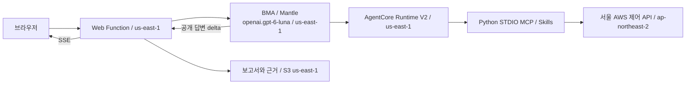

# AWS 배포 및 종단 간 검증

**2026-10-27 UTC, us-east-1 배포에 BMA 운영 조사, 재접속 복구와 절차 카탈로그를 추가하고 실조회 검증을 완료했다.**
현재 모델은 Mantle의 `openai.gpt-6-luna`이며 조회 대상은 같은 계정의 서울 리전이다.
요청에 적힌 `openai-gtp-6.0-luna`는 실제 지역 모델 목록과 BMA 세션 생성으로 확인한 공식 ID로 적용했다.

## 접속

- 웹 주소: https://kjg2885550xzd9cc.vft.lambda-web.us-east-1.on.aws
- 기존 접속 키를 그대로 사용한다. 키 파일은 `artifacts/deployment-secrets.json`이며 파일 모드는 `0600`이다.
- 키는 소스, 문서, 브라우저 번들에 포함하지 않는다. 인증하지 않은 API 요청은 401이다.
- 화면의 계정 ID는 `*********239`로 표시한다.

## 현재 배포

| 항목 | 실제 값 |
| --- | --- |
| 앱, BMA, Runtime, 결과 저장 리전 | `us-east-1`, 버지니아 북부 |
| AWS 리소스 조회 대상 | `ap-northeast-2`, 서울 |
| 모델 | `openai.gpt-6-luna` |
| 처리 경로 | `AGENT_BACKEND=bma`, 지역 Mantle 세션 |
| 모델 처리 범위 | `MODEL_PROCESSING_SCOPE=app_region` |
| Runtime | `bma_seoul_inventory-b47GS14QWS`, V2, 버전 `1`, READY |
| Web Function | `bma-seoul-inventory-web`, Node.js 24 |
| Web Revision | `rev-zdcqi`, 트래픽 100%, Active |
| 스택 | `bma-seoul-build`, `bma-seoul-inventory`, UPDATE_COMPLETE |
| 앱 결과 버킷 | `bma-seoul-inventory-appstate-rcrtiyvn592m` |
| 지원 범위 | 24개 MCP 도구, 4개 Skills, 13개 서비스 표시 범주 |

정확한 ARN, 이미지 digest, 코드 S3 VersionId는 [활성 배포 기록](../artifacts/aws-deployment.json)에 있다.
실제 배포 환경 변수와 웹 응답도 [설정 검증](../artifacts/migration-east/deployed-settings.json)으로 확인했다.

## 추가된 운영 조사

화면의 **운영 조사**에서 절차를 선택하고 같은 BMA 세션에 후속 질문을 보낼 수 있다.
별도 Lambda Event Function이 실행을 관리하며 재접속 시 S3의 공개 스냅샷을 복구한다.
절차 버전은 1.0.0이며 기존 24개 도구와 Runtime 버전 1은 유지했다.

- 로컬 검사: Python 302개, Node.js 206개, 총 508개 통과.
- 실제 같은 세션의 3개 turn: EC2 조회, 영어 요약, 첫 EC2 상태 점검 통과.
- 요약 시 리소스 재조회 0회, 원본 관측 시각 보존.
- 실제 브라우저에서 완료 전 새로고침 후 복구, 추가 POST 0회.
- HTML 미리보기와 네 가지 보고서 다운로드, 계정 마스킹, 언어/테마 검증 통과.
- 새 worker/WebRole의 실제 IAM 검사 12개 통과.

[사용 방법과 한도](bma-investigations.md),
[전체 검증](../artifacts/investigations/summary.json),
[배포 변경 세트](../artifacts/investigations/deployment.json).

아래의 리전 이전 검증은 운영 조사 추가 전 수행한 기록이다.

## 단일 질문의 BMA, Runtime, MCP 연결

Web Function은 자신의 STS 계정을 확인하고 BMA 세션을 만든다. MCP는 별도로 Runtime의 실제
실행 계정을 확인하며, 계정이 다르면 리소스 API 호출을 중단한다. 조회 정보 중 모델에 전달한
내용은 버지니아 북부에서 분석한다. 서울 조회가 서울 안에서만 처리된다는 뜻은 아니다.

저장된 조회 기록의 BMA 세션 ID로 실제 Mantle 세션을 다시 조회했다. 세션의 모델,
Runtime ARN, SessionRole과 `seoul_aws` MCP 호출이 모두 배포 설정과 일치했다.
[실제 세션 연결 근거](../artifacts/migration-east/bma-runtime-linkage.json)에 결과를 기록했다.

공개 텍스트 delta만 SSE로 전달한다. reasoning, analysis 메시지와 명령 실행 원문은
웹 화면이나 보고서에 표시하지 않는다. 선택 가능한 기존 Converse 구현은 남아 있지만
현재 배포는 BMA를 사용하며 글로벌 Converse 추론 권한을 부여하지 않는다.

## 리전 이전 당시 실제 조회 검증

| 검증 범위 | 결과 | 근거 |
| --- | --- | --- |
| EC2와 RDS 인벤토리 | 통과 | [66.37초](../artifacts/migration-east/e2e/inventory-20261027T043712Z.json) |
| EC2 상태 점검 | 통과 | [62.64초](../artifacts/migration-east/e2e/ec2-health-20261027T043906Z.json) |
| ECS 태스크 수와 배포 상태 | 통과 | [41.52초](../artifacts/migration-east/e2e/ecs-20261027T044015Z.json) |
| Lambda 구성과 최근 15분 지표 | 통과 | [45.62초](../artifacts/migration-east/e2e/lambda-20261027T043906Z.json) |
| VPC, EBS, ECR과 관계도 | 통과 | [40.56초](../artifacts/migration-east/e2e-extended/network-20261027T044016Z.json) |
| S3, DynamoDB, ElastiCache, OpenSearch, MSK 구성 | 통과 | [39.55초](../artifacts/migration-east/e2e-extended/configuration-20261027T044113Z.json) |
| 보안 그룹, EBS, RDS 구성 기준 | 통과 | [30.35초](../artifacts/migration-east/e2e-extended/security-20261027T044113Z.json) |
| 한국어 화면, ALARM 목록, HTML 미리보기 | 통과 | [28.69초](../artifacts/migration-east/e2e-ui/ko-alarms-browser-20261027T044219Z.json) |
| 영어 화면, ALARM 목록, 다크 모드 | 통과 | [29.94초](../artifacts/migration-east/e2e-ui/en-alarms-browser-20261027T044219Z.json) |

실제 조회 9건에서 **24개 도구 모두**, 정규화된 도구 결과 **37건**, AWS 요청 ID **72개**를 확인했다.
API 오류와 권한 오류는 없었다. 공개 답변 delta는 **5,255개**였다.
조회 한도로 잘린 목록은 `partial`, `pagination_complete=false`, `truncated=true`로 표시했다.
Lambda 지표가 비어 있는 경우는 데이터 없음으로 설명했으며 0이나 정상으로 바꾸지 않았다.

- UTC 관측 범위: `2026-10-27T04:38:06.000171Z` ~ `2026-10-27T04:42:35.056689Z`
- Asia/Seoul 표시: `2026-10-27 13:38:06` ~ `13:42:35` KST
- 전체 집계: [이전 및 검증 결과](../artifacts/migration-east/summary.json)

두 언어의 실제 Chromium 검사에서 Markdown이 완료 전에 렌더링되는 것을 확인했다.
NanumSquare OTF Bold, 계정 마스킹, 다크 모드, 모바일 표시와 HTML 미리보기도 통과했다.
저장된 네트워크 보고서를 이력에서 열고 Markdown, HTML, DOCX, PPTX로 내려받았다.
이력과 문서 변환은 새로운 모델 또는 AWS 리소스 조회를 실행하지 않았다.
[이력 및 문서 검증](../artifacts/migration-east/e2e-extended/browser.json).

## 기존 오레곤 배포 삭제

기존 프로젝트에 속한 BMA 세션 11개, CloudFormation 스택 2개, Web Function, Runtime,
IAM 역할 3개, S3 버킷 2개, ECR 저장소, 로그 그룹 2개를 삭제했다.
S3의 객체 버전까지 정리했으며 WebLogs의 `Retain` 설정으로 남은 로그도 별도로 삭제했다.
삭제 후 12개 확인 항목이 모두 통과했다. 서울 조회 리소스와 다른 프로젝트는 삭제하지 않았다.

기존 보고서와 이력 객체 71개는 삭제 전에 로컬 `artifacts/migration-east/previous-reports.zip`에
모드 0600으로 보관했다. 과거 관측 시각과 리전을 변경하지 않았으며 새 앱 이력으로 자동 복사하지 않았다.

- [삭제 작업 기록](../artifacts/migration-east/cleanup.json)
- [실제 삭제 확인](../artifacts/migration-east/deletion-verification.json)
- [삭제 전 오레곤 배포 기록](aws-deployment-oregon-2026-10-27.md)

## 권한, 한도와 로컬 검증

Runtime만 구현된 서울 조회 권한을 가진다. WebRole은 앱 상태와 BMA 호출을 담당하고,
SessionRole은 지정 Mantle 모델과 Runtime만 사용한다. AWS 관리형 ReadOnlyAccess는 사용하지 않는다.
실제 역할의 IAM 시뮬레이션 18개가 통과했다. 타 리전 조회, 타 계정 리소스, 변경 API,
다른 Runtime, 글로벌 Converse 추론, Runtime의 앱 결과 접근이 차단되는 것을 확인했다.
[권한 검증](../artifacts/migration-east/iam-verification.json).

| 항목 | 현재 값 |
| --- | --- |
| 도구별 최대 반환 리소스 | 2 |
| 최대 페이지 | 2 |
| 지표 기간 상한 | 1시간, 실제 검증은 첫 함수의 15분 |
| 최대 지표 포인트 | 100 |
| 도구별 SDK 호출 | STS 포함 최대 31회 |
| 에이전트 turn 제한 | 300초 |
| Runtime idle / lifetime | 900초 / 28,800초 |

서비스 API의 최소 페이지 크기가 더 큰 경우에도 모델에 반환하는 수는 위 한도를 따른다.
조회 비용의 금액 상한을 보장하지는 않는다.

리전 이전 당시 Python 278개와 Node.js 73개, **총 351개 로컬 검사**를 통과했다.
운영 조사 추가 후의 최신 전체 검사는 앞 절의 508개다.
리전 지정, 계정 불일치, 페이지네이션, 권한 거부, 빈 결과, 지표 없음, 부분 실패와 민감 필드 제거를 포함한다.
최종 Runtime 컨테이너도 네트워크 차단 상태에서 MCP, 사용자 UID, Skills와 lifecycle 검사를 통과했다.
AWS의 us-east-1 템플릿 검증은 통과했다. cfn-lint 오류는 없었으며 알려진 BMA preview IAM
액션 카탈로그 경고 6개는 남아 있다. 공식 lifecycle 파일은 변경하지 않았다.
원본 awsops 파일 20개의 해시도 일치했다.

## 미지원 범위

이 결과는 조회한 서비스와 범위에 한정된다. 계정 전체 자원 수나 전체 서비스 정상 판정이 아니다.
DB SQL, 객체/테이블/검색 데이터, 사설 HTTP, Kubernetes API, 로그 검색, 비용 분석,
리소스 변경 API는 제공하지 않는다. 제어 API 조회를 위한 VPC Peering은 만들지 않았다.

단일 질문은 질문마다 새 BMA 세션을 만든다. 운영 조사는 같은 세션을 이어 쓰며
후속 질문과 재접속을 지원한다. 성공한 BMA 세션과 앱 S3 기록의
수명주기는 별도이며 앱 결과 만료가 BMA 세션 삭제를 뜻하지 않는다.
DOCX/PPTX는 ZIP/XML 구조와 실제 다운로드를 검증했으며 데스크톱 Office의 시각적 검사는 수행하지 않았다.
