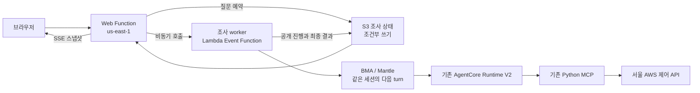

# BMA 운영 조사

2026-10-27, 같은 BMA 세션에서 질문을 이어가는 운영 조사, 재접속 복구,
버전이 지정된 운영 절차 카탈로그를 기존 웹 앱에 추가하고 배포했다.
모델은 `openai.gpt-6-luna`, 앱과 모델 실행은 `us-east-1`, 조회 대상은 `ap-northeast-2`다.

## 사용 방법

1. 기존 접속 키로 연결하고 **운영 조사**를 선택한다.
2. 리소스 인벤토리, 서비스 상태 점검, 보안 구성 점검, 운영 보고서 중 절차를 선택한다.
3. 질문을 입력해 조사를 시작한다. 절차의 버전과 단계별 실제 실행 상태가 표시된다.
4. 결과를 받은 뒤 같은 조사에서 후속 질문을 보낸다.
   예: “앞서 조회한 첫 번째 EC2만 상태 점검해 줘.”
5. 새로고침 후 접속 키를 다시 입력하면 마지막으로 열었던 조사를 복구한다.
   **최신 진행 다시 연결**은 같은 실행 결과를 다시 읽으며 질문을 재제출하지 않는다.
6. 질문 이력에서 이전 결과를 열고 HTML 미리보기 또는 Markdown, HTML, DOCX, PPTX로 저장한다.
7. **조사 중단**은 진행 중인 BMA 작업에만 적용된다. AWS 리소스의 중지 작업이 아니다.

기존 **단일 질문** 모드는 그대로 제공한다. 운영 절차는 조사 도중 변경하지 않으며
다른 절차가 필요하면 새 조사를 만든다.

## 실행과 복구

worker가 BMA 실행을 관리하므로 브라우저 연결이 없어도 제한 시간 안에서 작업을 계속한다.
진행 답변과 정규화된 도구 결과를 최대 초당 한 번 저장하고 웹은 저장된 스냅샷을 SSE로 전달한다.
모델의 토큰마다 S3를 쓰지는 않는다. 기존 단일 질문 모드는 BMA의 공개 text delta를 직접 전달한다.

새 질문에는 UUID가 붙는다. 같은 UUID와 입력을 다시 보내도 기존 실행을 반환하며 다른 입력은 거부한다.
S3의 `If-None-Match`와 `If-Match`로 질문 예약과 worker 소유권을 조정한다.
worker lease는 45초이며 갱신된다. 중복 worker는 실행을 반복하지 않는다.
취소도 현재 lease 소유권을 확인한 뒤 수행한다.

BMA 입력 전송 결과가 불명확하면 고유 표식과 실제 `turn_id`로 수락 여부를 확인한다.
입력이 수락됐는지 입증할 수 없으면 `uncertain` 상태로 남기며 같은 질문을 자동 재제출하지 않는다.
확인되지 않은 취소나 실행 상태도 완료로 표시하지 않는다.

## 관측 근거

새 turn의 실제 입력 item과 `turn_id`로 이번 도구 결과를 구분한다.
이전 turn의 결과를 현재 관측에 섞지 않는다. 이전 근거만 요약한 경우:

- `evidence_reused=true`, `source_run_ids`를 기록한다.
- 원본 `observed_at`를 그대로 보존한다.
- 화면과 모든 보고서 형식에 이전 근거 재사용 사실을 표시한다.

후속 질문의 언어와 상대 시간 기준은 매번 새로 전달한다.
계정, 리전, 데이터 없음, 권한 거부, 부분 조회의 기존 처리 규칙은 유지한다.
단계 완료는 작업 수행 상태이며 애플리케이션 정상이나 보안 적합 판정이 아니다.

## 저장, 권한과 비용 한도

| 항목 | 범위 |
| --- | --- |
| 조사 | 최대 10개 질문, 후속 질문 허용 기간 6시간 |
| 실행 | 질문당 300초, worker 함수 timeout 360초 |
| worker | ARM64 Node.js 24, 512 MB, 동시 실행 2개 |
| 비동기 재시도 | 최대 1회, 이벤트 최대 보관 600초 |
| 상태 저장 | `investigations/ACCOUNT/ap-northeast-2/`, 조사 128 KiB, turn 4 MB |
| 보관 | 현재 버전 7일, 비현재 버전 1일 |
| 진행 저장/전달 | 스냅샷 최대 초당 1회, 변화와 heartbeat 표시 |
| 리소스 조회 | 기존 상한 2개, 2페이지, 지표 최대 1시간 |

BMA 세션과 Runtime의 자체 수명주기는 별도다. 만료되거나 재개할 수 없는 세션을
정상 재개한 것처럼 표시하지 않는다.

WebRole은 지정 worker 함수만 비동기로 호출한다. 새 WorkerRole은 BMA 세션 API,
지정 SessionRole의 PassRole, 자신의 로그와 앱 버킷의 지정 경로만 사용한다.
모델 추론과 Runtime 연결은 기존 SessionRole, 서울 조회는 기존 RuntimeRole이 담당한다.
worker에 EC2/RDS 조회, 직접 모델 추론, Runtime 직접 호출 권한을 주지 않는다.

없는 S3 객체가 권한 부족과 같은 403으로 반환될 수 있어, 검증된 정확한 객체 키만
`ListObjectsV2(MaxKeys=1)`로 확인한다. IAM도 UUID 형태의 키와 `s3:max-keys<=1`로 제한한다.
객체가 존재하거나 탐색 결과가 불확실하면 원래 권한 오류를 유지한다.

추가 비용 항목은 worker Lambda 실행과 S3 상태 읽기/쓰기다.
worker의 감시, lease, 스냅샷 처리에는 복수의 S3 API 호출이 필요하다.
초당 스냅샷 상한이 전체 S3 API 호출 수나 비용 금액의 상한을 뜻하지는 않는다.
로그 검색, 비용 분석, 리소스 변경 API는 새로 추가하지 않았다.

브라우저에는 마지막 조사 ID만 보관하며 접속 키, 계정 ID, 질문과 결과를 localStorage에 저장하지 않는다.
내부 추론, 원문 명령 실행 결과, worker lease와 BMA 세션 ID는 공개 스냅샷에서 제외한다.

## API

| 요청 | 동작 |
| --- | --- |
| `GET /api/procedures` | 사용 가능한 절차와 버전 |
| `POST /api/investigations` | 조사와 첫 질문 예약 |
| `GET /api/investigations` | 범위가 제한된 조사 목록 |
| `GET /api/investigations/:id` | 현재 상태 복구 |
| `POST /api/investigations/:id/turns` | 같은 조사의 후속 질문 |
| `GET /api/investigations/:id/turns/:run_id` | 특정 질문의 상태/결과 |
| `GET /api/investigations/:id/turns/:run_id/events` | 공개 상태의 SSE |
| `POST /api/investigations/:id/turns/:run_id/cancel` | BMA 조사 중단 요청 |

모든 API에 기존 접속 키와 계정 검증을 적용한다.
사용자의 자유 입력 계정 ID, 리전, BMA 세션 ID, 파일 경로는 받지 않는다.

## 검증 결과

- Python 302개, Node.js 206개, 총 508개 로컬 검사 통과.
- 실제 같은 BMA 세션에서 3개 turn: EC2 최대 2개 조회, 영어 요약, 앞서 관측한 첫 EC2 1개 상태 점검.
- 요약 turn의 신규 리소스 API 호출 0회, 원본 관측 시각 보존.
- 첫 SSE 연결 중단 후 재연결해 같은 실행을 복구.
- 실제 브라우저에서 ALARM 최대 2개 조회 한 건을 시작하고 완료 전 새로고침.
  추가 POST 없이 같은 조사를 복구하고 네 가지 형식 내보내기 통과.
- 실제 Worker/Web 역할의 권한 검사 12개 통과.
- 기존 Runtime 버전 1과 24개 MCP 도구 유지.

[API 및 BMA 검증](../artifacts/investigations/live/summary.json),
[브라우저 검증](../artifacts/investigations/browser/latest.json),
[실제 IAM 검증](../artifacts/investigations/iam-live.json),
[검토 기록](../artifacts/investigations/final-review.md).

변경 전후 비교 보고서와 세션 간 자동 장기 기억은 이번 구현 범위에 포함하지 않는다.
