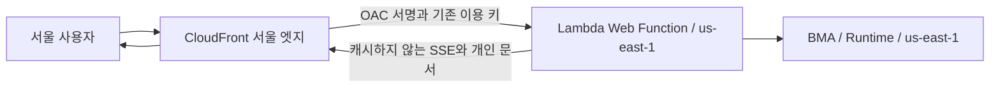

# CloudFront와 Lambda Web OAC 배포 결과

2026-10-27 UTC에 운영 데스크와 문서 스튜디오의 CloudFront 배포, OAC 연결과 원본 접근 제한을 완료했다.
기존 이용 키를 그대로 사용한다. 모델과 Runtime은 us-east-1에 유지한다.

| 앱 | 새 접속 주소 | 모델 |
| --- | --- | --- |
| AWS Operations Desk | https://d1ectepf9xg5lq.cloudfront.net | `openai.gpt-6-luna` |
| AI Document Studio | https://d3gmtgr1d0tjcl.cloudfront.net | `openai.gpt-6.1-sol` |

| 항목 | 운영 데스크 | 문서 스튜디오 |
| --- | --- | --- |
| CloudFront 배포 | `E29FC3EO2B1EO7` | `E26EBBB2JKQPH4` |
| OAC | `E26MHANVN9NN7J` | `E2JX6HBMK4KP0C` |
| 원본 인증 | `IamAuth` | `IamAuth` |
| Web Revision | `rev-vsnke` | `rev-dlldl` |
| Runtime 버전 | `1`, 변경 없음 | `2`, 변경 없음 |
| 관측한 서울 엣지 | `ICN80-P4` | `ICN57-P6` |

OAC는 `lambda`, `sigv4`, `always-amz-auth`를 사용한다. Web Function 리소스 정책은
해당 CloudFront 배포 ARN에서 해당 endpoint ARN으로 호출하는 경우만 허용한다.
기존 Lambda Web 원본 주소는 이용 키를 넣어도 403을 반환한다. 브라우저에서는 새 주소를 사용한다.
CloudFront는 PriceClass_All, HTTP/2·HTTP/3, IPv6와 HTTPS 원본 연결을 사용한다.

## 캐시와 인증

- 공개 HTML: 브라우저 재검증, 엣지 최대 60초.
- JS, CSS, 폰트: 브라우저 최대 300초, 엣지 최대 3,600초.
- Authorization 또는 Cookie가 있는 정적 요청: 원본은 `no-store`를 반환한다.
- API, SSE, 업로드와 개인 문서 다운로드: CloudFront 최소·기본·최대 TTL 모두 0, 원본도 `no-store`.
- 오류 응답의 캐시 TTL: 0. 동적 응답 압축은 꺼서 스트리밍 버퍼링을 피한다.

현재 계정의 사용자 지정 캐시 정책 한도가 20개로 모두 사용 중이었고, 기존 정책에는 필요한
Authorization 전달 설정이 없었다. 다른 프로젝트의 정책을 삭제하거나 바꾸지 않고, 각 배포의
인라인 `ForwardedValues`에 헤더·쿼리·쿠키 전달과 TTL을 지정했다. 실제 인증된 GET과 파일 POST로
동작을 확인했다. 일반 API에서 Authorization, Content-Type, X-File-Name, Last-Event-ID, Origin,
Accept를 전달하고, viewer Host는 전달하지 않는다.

공개 정적 화면만 서울 엣지에 캐싱된다. 모델이 처리하는 내용과 개인 문서는 엣지 캐시에 저장하지 않는다.
CloudFront를 추가해도 모델의 실행 리전이나 문서 생성 연산은 서울로 이동하지 않는다.

## 서울 측정

같은 `ap-northeast-2a` EC2에서 경로별 세 번의 새 HTTP/1.1 연결로 측정했다.
적용 후 값은 한 번 예열한 뒤 캐시 HIT 세 번의 중앙값이다.
EC2 인스턴스 identity document로 측정 리전을 확인했다.

| 앱 | HTML 첫 응답, 적용 전 | 캐시 HIT 첫 응답 | 폰트 전체 수신, 적용 전 | 캐시 HIT 폰트 수신 |
| --- | ---: | ---: | ---: | ---: |
| 운영 데스크 | 578.76ms | 11.46ms | 2,287.88ms | 20.33ms |
| 문서 스튜디오 | 593.44ms | 10.65ms | 1,606.75ms | 18.04ms |

단일 서울 EC2의 소규모 측정이다. 가정·회사 회선, 캐시 MISS, 다른 지역의 성능을 보장하는 수치가 아니다.
모델 생성 시간의 변화는 측정하지 않았다.

## 검증한 범위

- 두 CloudFront 배포와 OAC 서명 설정, 원본 직접 접근 및 이용 키 우회 접근의 403.
- 올바른 이용 키의 API 200, 누락·잘못된 키의 API 401, 인증 결과가 캐시되지 않는지 확인.
- JS와 폰트의 캐시 HIT, 서울 엣지 식별자.
- 기존 완료 결과의 SSE `snapshot`과 `complete`, 원본 작업 상태가 바뀌지 않는지 확인.
- 기존 HTML 미리보기, PNG·SVG·PPTX·DOCX·HTML 다운로드와 S3 SHA256 일치.
- 24바이트 CSV의 인증된 업로드와 한글 파일명·저장 내용 일치. 새 생성 작업은 만들지 않음.
- 실제 Chromium에서 로그인, 모델 표시, 계정 마스킹, 한국어·영어, 다크 모드와 모바일.
- 브라우저 JavaScript 오류 0, 새 모델 호출 0.

이번 검증은 기존 완료 결과를 사용했다. 활성 장기 생성 스트림을 새로 실행한 검증은 아니다.

검증 기록은 배포 환경의 `artifacts/cloudfront/`에 있으며 저장소에는 포함하지 않는다.

| 파일 | 내용 |
| --- | --- |
| `deployment.json` | 두 배포, OAC, 원본 인증과 주소 |
| `verification.json` | HTTP, 파일, SSE 검증 |
| `browser/summary.json` | 실제 브라우저 검증 |
| `probe-location.json` | 서울 EC2 측정 위치 |
| `latency-before.json`, `latency-after.json` | 적용 전후 원본 측정값 |
| `final-state.json` | 실제 정책, IamAuth, 코드 일치, Runtime·역할 유지 확인 |
| `summary.json` | 배포와 검증 집계 |

CloudFront 관련 테스트 73개를 통과했다. 두 앱의 배포된 Web 소스와 Worker 코드가
검증한 ZIP과 일치하며, 각 앱의 네 역할 정의와 Runtime 버전이 유지된 것도 확인했다.

재배포·캐시 무효화·복구 절차는 [CloudFront OAC 운영 절차](runbooks/cloudfront-oac.md)를 따른다.
CloudFront 요청과 전송에 대한 일반 요금은 발생할 수 있다.

공식 참고 문서:

- https://aws.amazon.com/ko/about-aws/whats-new/2026/10/cloudfront-lambda-web-functions-origin/
- https://docs.aws.amazon.com/AmazonCloudFront/latest/DeveloperGuide/private-content-restricting-access-to-lambda-web.html
