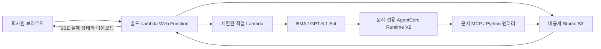

# AI Document Studio 사용 안내

비개발자와 회사원이 엑셀, CSV, 텍스트 또는 메모를 넣고 차트, 다이어그램, PPT와 Word를 만드는 별도 데모다.
기존 AWS 운영 데스크는 유지하고 새 Lambda Web Function과 문서 전용 Runtime으로 배포했다.

## 접속과 사용

- 주소: https://fxpdl40ymkzmzv1n.vft.lambda-web.us-east-1.on.aws
- 기존 운영 데스크의 이용 키를 사용할 수 있다. 키는 소스나 이 문서에 포함하지 않는다.
- 현재 모델: **`openai.gpt-6.1-sol`**, BMA, `us-east-1`.

1. 이용 키로 연결한다.
2. XLSX, CSV, TXT, MD 파일 하나를 올리거나 메모를 붙여 넣는다.
3. 원하는 결과를 자연어로 쓰고 PPTX, DOCX, 차트, 다이어그램 중 필요한 출력을 선택한다.
4. 업무 보고서, AWS 운영 데스크, 발표 자료 중 스타일을 선택한다.
5. 작업 중 문서/차트 애니메이션, 실제 단계와 경과 시간을 확인한다.
6. 완료 후 내용 미리보기와 다운로드를 사용한다. 같은 자료를 다른 스타일로 만들 때는 **새 버전 만들기**를 선택한다.

엑셀 예제: “월별 매출을 막대 차트로 만들고, 차트를 포함한 발표자료와 Word 보고서를 만들어 줘.”
메모 예제: “이 온보딩 메모를 업무 흐름도로 정리하고 PPT와 Word 안내서를 만들어 줘.”

[샘플 엑셀](../studio/examples/monthly-sales.xlsx),
[샘플 업무 메모](../studio/examples/onboarding-notes.txt). 영어 예제는 같은 폴더의 `-en` 파일이다.

## 결과물

| 입력 | 결과 |
| --- | --- |
| 엑셀/CSV | 실제 열과 수치로 집계한 막대, 선, 원형 또는 산점도 |
| 절차/구조 메모 | 흐름, 계층 또는 시간 순서 다이어그램 |
| 텍스트/메모/데이터 | 편집 가능한 PPTX와 DOCX, HTML 내용 미리보기 |
| 기존 작업 | 같은 입력을 사용하는 새 스타일/지시의 별도 생성 작업 |

PPT 차트에는 편집 가능한 데이터와 차트 객체가 들어간다. 다이어그램은 가능한 경우 도형과 연결선으로 만든다.
Word 본문은 편집 가능하며 차트와 다이어그램은 이미지로 포함한다.
HTML은 내용 미리보기다. 실제 Office의 글꼴, 줄바꿈과 페이지 배치는 사용 환경에 따라 달라질 수 있다.
나눔스퀘어가 없는 PC에서는 대체 글꼴이 사용될 수 있다.

## 모델과 정확성

초기 Luna 시험에서는 차트를 만들었지만 한 사례에서 문서의 차트 참조를 잘못 연결했다.
문서 제작 모델을 GPT-6.1 Sol로 전환하고 세 가지 실제 생성 흐름을 검증했다.
Terra 6.1도 지역 Mantle 후보 목록에서 확인했으나 이 배포의 생성 모델로 사용하거나 품질을 검증하지 않았다.
모델은 구성과 문장을 작성한다. 실제 숫자 집계, 차트와 Office 파일 생성은 제한된 Python MCP 도구가 수행한다.

빈 값과 수식의 저장 값이 없는 셀을 0으로 바꾸지 않는다. 수식을 실행하거나 다시 계산하지 않는다.
원본 자료와 열 이름, 생략/누락 경고를 결과에 남긴다. 긴 표시 라벨을 줄이면 그 사실을 알리고 원문을 보존한다.
다운로드할 파일이 실제로 생성되기 전에는 완료 파일로 표시하지 않는다.

## 구조와 데이터 흐름

앱, BMA, Runtime과 파일 처리는 us-east-1에 있다. 원본 파일과 메모 중 도구가 전달한 내용은 BMA 분석에 사용된다.
브라우저에는 이용 키나 원본 파일/메모를 영구 저장하지 않고, 화면 환경과 마지막 작업 ID만 저장한다.
새 생성 작업마다 별도 BMA 세션을 사용하며, 이전 입력 재사용은 `source_job_id`로 명시한다.

문서 Runtime은 문서 전용 S3 경로만 사용하며 EC2, RDS 등 AWS 리소스 조회 권한이 없다.
Web, worker, BMA 세션, Runtime 역할을 분리했다. 기존 운영 데스크 역할이나 데이터 버킷의 권한을 늘리지 않았다.
MCP는 고정된 작업 ID의 자료만 처리하며 범용 CLI, 임의 Python 코드 실행, 매크로 실행 도구를 제공하지 않는다.
이용 키를 공유하는 신뢰된 사용자 그룹용 데모이며 사용자별 테넌트 서비스는 아니다.

## 한도와 보관

| 항목 | 한도 |
| --- | --- |
| 파일 | 한 번에 1개, 최대 5 MiB |
| 형식 | XLSX, CSV, TXT, MD; XLS/XLSM/PDF 입력은 미지원 |
| 표 | 최대 5시트, 10,000행, 50열, 총 100,000셀 |
| 텍스트/메모 | 각각 최대 50,000자, 긴 내용은 제한된 페이지로 읽음 |
| 시각 자료 | 최대 6개, 차트 범주 최대 50개 |
| 다이어그램 | 최대 20노드, 30연결 |
| 발표자료 | 제목 포함 최대 12슬라이드 |
| 출력 파일 | 각 10 MiB, 합계 30 MiB |
| 실행 | 작업당 300초, worker timeout 360초, 동시 worker 2개 |
| 초기 입력 요청 | 준비 중 연결을 최대 150초 기다리며 전체 작업 시간 한도 안에서 동작 |
| 보관 | S3 현재 파일 7일, 비현재 버전 1일 |

BMA 세션 보관은 S3 파일 만료와 별도다. 모델 추론, Lambda, Runtime, S3, ECR과 데이터 전송 비용이 발생할 수 있다.
한도는 요청과 데이터 크기를 제한하며 과금 금액의 절대 상한을 보장하지 않는다.

## 실제 검증

| 흐름 | 결과 |
| --- | --- |
| 엑셀 → 업무 보고서 스타일 차트/PPT/Word | 통과, 53.03초 |
| 같은 엑셀 → 발표 자료 스타일 | 통과, 32.45초 |
| 메모 → AWS 데스크 스타일 흐름도/PPT/Word | 통과, 40.43초 |

총 15개 파일을 생성하고 내려받았다. PPT의 실제 편집 가능한 차트 값이 원본 여섯 값과 일치했다.
실제 브라우저에서 작업 애니메이션, 완료 전 새로고침 복구, 한국어/영어, 다크 모드, 모바일과 HTML 미리보기를 확인했다.
새로고침으로 추가 생성 요청은 발생하지 않았다.

로컬 테스트 113개, 문서 역할의 실제 권한 검사 10개, 네트워크 차단 컨테이너 생성 검사를 통과했다.
기본 초기 입력 경로의 대기 시간을 보완했으며, 수락 여부가 불명확한 요청을 자동 재전송하지 않는다.
최종 BMA 세션의 모델과 문서 Runtime, 실제 문서 MCP 호출을 별도로 대조했다.

검증 기록은 배포한 작업 환경의 `artifacts/studio/`에 있으며 `.gitignore` 대상이라 저장소에는 포함하지 않는다.

| 파일 | 내용 |
| --- | --- |
| `summary.json` | 검증 집계 |
| `bma-proof.json` | 실제 BMA 연결 |
| `live-browser/summary.json` | 브라우저 결과 |
| `iam-live.json` | IAM 검증 |
| `source.zip` | 소스와 검증 기록 |
| `final-state.json` | 최종 배포 상태 |
| `final-package-proof.json` | 소스/배포 코드 일치 검사 |

## 로컬 테스트와 화면

AWS와 모델을 호출하지 않는 테스트 명령과 가상 환경 준비는 [`studio/CLAUDE.md`](../studio/CLAUDE.md)에 있다.
README 화면은 `.venv/bin/python scripts/capture_screenshots.py studio`로 다시 만든다.
실제 Studio 서버 경로와 Python 렌더러가 `studio/examples/`로 만든 파일을 사용하고, 답변 문장만 고정 예시다.
배포와 갱신 절차는 [Document Studio 배포 runbook](runbooks/deploy-document-studio.md)을 따른다.
